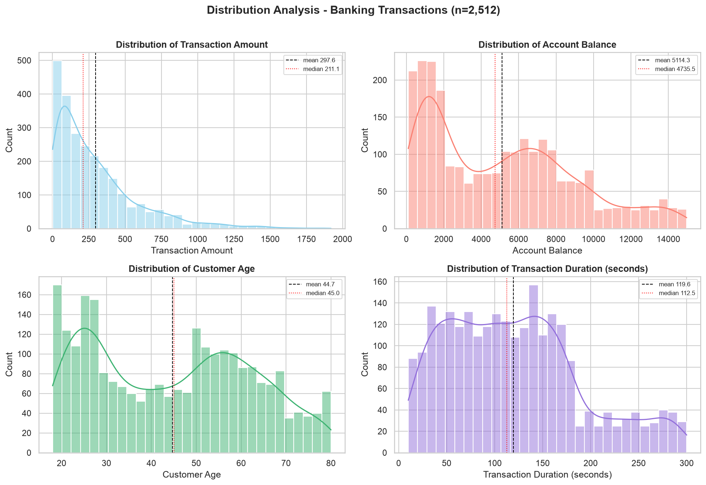
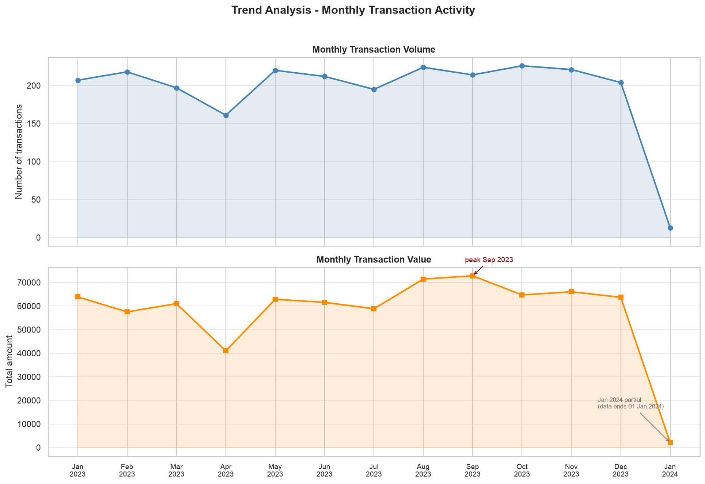
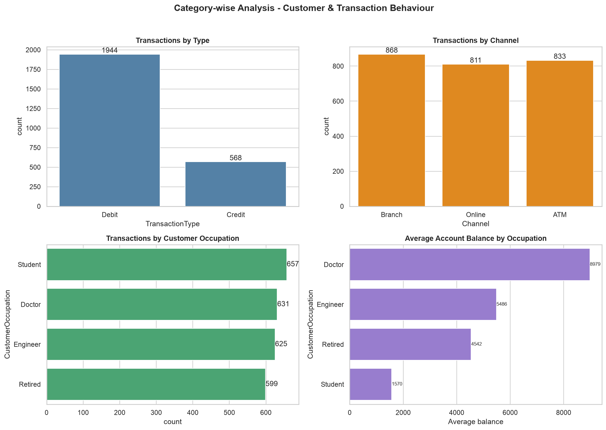
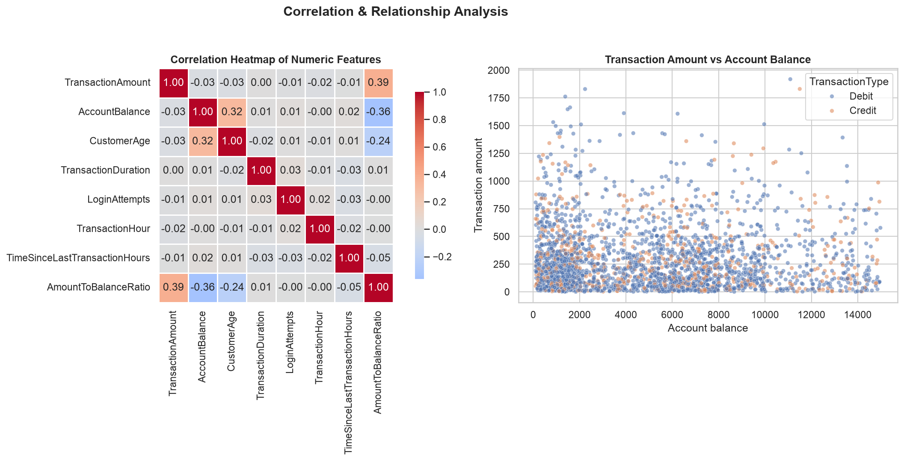
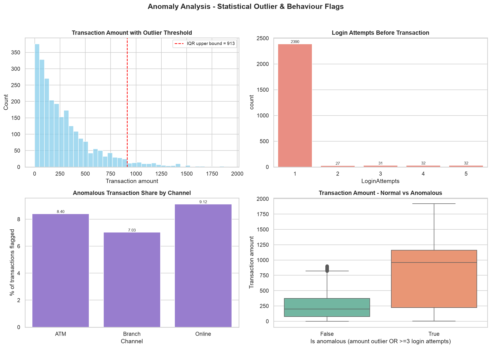

# Banking Transaction Anomaly & Customer Behaviour EDA

**Industry:** IDFC FIRST Bank — Banking & Financial Services (BFSI)

An end-to-end **Python data-analysis (EDA)** project that studies a year of retail
banking transactions to understand **customer behaviour** across channels,
transaction types and occupations, and to surface **statistical anomalies**
(unusually large amounts and suspicious login behaviour) that could indicate
fraud-risk.

> **Note on the data:** this project uses a *synthetic* retail-banking dataset
> that has **no ground-truth fraud label**. "Anomaly" therefore means a
> **statistical outlier / behavioural flag** (IQR, z-score, login behaviour) —
> not a confirmed fraud case. All figures in this repository were produced by
> running the code on the actual dataset.

---

## Problem Statement

Retail banks process thousands of transactions every day. Two recurring BFSI
challenges are:

1. **Anomaly / fraud-risk monitoring** — a small share of transactions are
   unusually large or occur after suspicious repeated login attempts. These are
   hard to spot manually in high-volume data.
2. **Understanding customer behaviour** — spending patterns differ by channel
   (ATM / Online / Branch), transaction type (Credit / Debit) and customer
   occupation. Behavioural insight is needed for segmentation and risk policy.

Without structured exploratory analysis, banks cannot tell *which* transactions
and *which* customer segments deserve closer attention.

## Proposed Solution / Analysis Questions

Use Python (Pandas, NumPy, Matplotlib, Seaborn) to clean and explore one year of
transaction data and answer:

- What do the distributions of **transaction amount, account balance, customer
  age and transaction duration** look like?
- How does activity and value split across **transaction type, channel and
  customer occupation**?
- How does activity vary **over time** — by month, day of week and hour of day?
- Which transactions are **statistical/anomaly outliers** (large amounts, high
  login attempts), and how do anomalous transactions differ from normal ones?
- What **relationships** exist between amount, balance, age, duration and login
  attempts?

---

## Dataset

| Item | Detail |
|---|---|
| **Dataset name** | Bank Transaction Dataset for Fraud Detection |
| **Source** | Kaggle — `valakhorasani/bank-transaction-dataset-for-fraud-detection` |
| **Original file** | `bank_transactions_data_2.csv` |
| **Rows × Columns** | 2,512 × 16 (raw) |
| **Period covered** | 2 Jan 2023 → 1 Jan 2024 |
| **Accounts** | 495 unique accounts (1–12 transactions each) |
| **Nature of data** | Synthetic, realistic retail-banking transactions |

**Raw columns:** `TransactionID, AccountID, TransactionAmount, TransactionDate,
TransactionType, Location, DeviceID, IP Address, MerchantID, Channel,
CustomerAge, CustomerOccupation, TransactionDuration, LoginAttempts,
AccountBalance, PreviousTransactionDate`.

**Data quality:** 0 missing values, 0 duplicate rows, 0 negative amounts. The
only values that require handling are the 495 first-transaction records per
account, which have no preceding transaction (blank
`TimeSinceLastTransactionHours`).

**Currency:** the dataset does not specify a currency, so all monetary values
below are reported in the dataset's own (unit-less) amount.

### Tools & Technologies

- Python
- Jupyter Notebook
- NumPy
- Pandas
- Matplotlib
- Seaborn
- `uv` (virtual-environment / dependency management)

---

## Project Workflow

```
Industry Selection
      ↓
Problem Identification
      ↓
Dataset Collection
      ↓
Data Cleaning
      ↓
Data Transformation
      ↓
Data Analysis
      ↓
Data Visualization
      ↓
Insights
      ↓
Recommendations
```

| Stage | Where it happens |
|---|---|
| Dataset Collection | `Python/data_loading.py` |
| Data Cleaning & Transformation | `Python/data_cleaning.py` |
| Data Analysis | `Python/exploratory_analysis.py` |
| Data Visualization | `Python/data_visualization.py` |
| Narrative walkthrough | `Notebook/Data_Analysis_EDA.ipynb` |

**Transformation performed:** parsed `TransactionDate` into Year / Month /
Month-name / Day-of-week / Day-name / Hour, derived `IsWeekend`, computed
per-account `TimeSinceLastTransactionHours` (transaction velocity),
`AmountToBalanceRatio`, and `SignedAmount` (negative for Debits, positive for
Credits). Anomaly flags are added by the analysis stage.

---

## Data Analysis & Visualization

Only the analyses below were actually performed.

| # | Analysis | What it covers |
|---|---|---|
| 1 | **Distribution Analysis** | Transaction amount, account balance, customer age, transaction duration |
| 2 | **Category-wise Analysis** | Transaction type, channel, customer occupation |
| 3 | **Trend Analysis** | Monthly transaction volume and value |
| 4 | **Time-based Analysis** | Hour-of-day and day-of-week patterns |
| 5 | **Comparison Analysis** | Credit vs Debit; channel-wise comparison |
| 6 | **Relationship Analysis** | Amount / balance / age / duration / login-attempt pairs |
| 7 | **Correlation Analysis** | Correlation heatmap of numeric features |
| 8 | **Anomaly Analysis** | IQR & z-score amount outliers, login-behaviour flags |

---

## Key Insights

All numbers below are computed from the dataset (2,512 transactions).

1. **Spending is right-skewed — a few large transactions dominate.**
   Transaction amount: median **211.14**, mean **297.59**, max **1,919.11**;
   skewness **+1.74**. The 95th percentile is **878.18** and the 99th
   **1,360.60**, so a small tail of transactions is far above typical spend.

2. **Debits vastly outnumber credits.** **1,944 Debits (77.4%)** versus
   **568 Credits (22.6%)**. Average value is almost identical (Debit 294.99 vs
   Credit 306.50), so the difference is in *frequency*, not ticket size.

3. **Channels are evenly used.** Branch **868**, ATM **833**, Online **811** —
   each channel carries roughly one-third of transaction value
   (Branch 33.5%, ATM 34.3%, Online 32.2%).

4. **Occupation shapes account balance dramatically.** Average balance:
   Doctor **8,978.99**, Engineer **5,486.41**, Retired **4,542.16**, Student
   **1,570.21**. Interestingly, Students have the **highest average
   transaction amount (313.22)** despite the lowest balances — they spend a
   larger share of what they hold.

5. **Transaction activity peaks in September 2023.** Peak monthly value
   **72,832.25** (Sep 2023); the weakest full month was **April 2023
   (41,003.84)**; monthly average value **57,504.27**. The January 2024 figure
   is only partial (data ends 1 Jan 2024).

6. **Activity is concentrated at end-of-day and early week.** Every transaction
   falls between **16:00 and 18:59** (16:00 → 1,316 transactions, 52.4%), and
   **Mondays** account for **1,070 transactions (42.6%)**. There are **no
   weekend transactions** at all.

7. **Most numeric features are essentially uncorrelated.** No pair reaches
   |r| ≥ 0.4. The strongest links are balance↔age (**r = 0.32**) and
   amount↔amount-to-balance ratio (**r = 0.39**). Transaction amount is
   virtually uncorrelated with duration (0.004), login attempts (−0.008) and
   balance (−0.025).

8. **A measurable anomaly tail exists.** Using the IQR rule, the outlier
   threshold is **913.49**, flagging **113 transactions (4.50%)**. The z-score
   rule (|z| > 3) flags **48 (1.91%)**, and **95 transactions (3.78%)** have
   ≥3 login attempts. A combined flag (large amount **or** ≥3 login attempts)
   marks **205 transactions (8.16%)**.

9. **Anomalous transactions look very different from normal ones.**
   Anomalous average amount **768.76** vs **255.73** for normal; anomalous
   median 959.48 vs 199.02; average login attempts **2.40** vs **1.01**.

10. **Online is the channel with the highest anomalous share** (**9.12%**),
    ahead of ATM (8.40%) and Branch (7.03%). Anomalous transactions cluster in
    a handful of cities (Austin, Fort Worth, San Diego, Philadelphia, Columbus).

---

## Recommendations

Based only on the findings above:

1. **Prioritise amount-based monitoring around the 913.49 IQR threshold.** Transactions
   above the IQR upper bound (4.5% of volume) carry disproportionate value and
   deserve rule-based review.

2. **Treat repeated login attempts as a first-class risk signal.** Transactions
   with ≥3 login attempts are ~2.4× as common among flagged records; step-up
   authentication after the 2nd failed attempt is low-cost and targeted.

3. **Watch the Online channel most closely.** It shows the highest anomalous
   share (9.12%); combining it with the amount and login rules sharpens the
   alert list without flagging everything.

4. **Segment risk policy by occupation/balance band.** Students hold the lowest
   balances (1,570) yet transact at the highest average amount — a
   high-balance-usage cohort worth monitoring for balance-drain patterns.

5. **Account for the data's time limitation.** Because the dataset only spans
   16:00–18:59 on weekdays, off-hours and weekend monitoring rules cannot be
   validated from it; treat this as a data-collection gap, not evidence that
   such activity is absent.

6. **Enrich the data to make anomalies actionable.** The dataset has no
   ground-truth fraud label, so flagged transactions are statistical, not
   confirmed. Adding a labelled fraud column (or device/location reputation
   feeds) would turn these flags into a trainable risk model.

---

## Visualization Screenshots

### Distribution Analysis



### Trend Analysis



### Category-wise Analysis



### Correlation Analysis



### Anomaly Analysis



---

## Project Folder Structure

```
BankingAnamolyDetection/
│
├── README.md
├── requirements.txt
│
├── Dataset/
│   ├── raw_dataset.csv            # original data (2,512 x 16)
│   └── cleaned_dataset.csv        # cleaned + engineered features + anomaly flags
│
├── Notebook/
│   └── Data_Analysis_EDA.ipynb    # executed notebook with outputs
│
├── Python/
│   ├── data_loading.py            # download + load + summary
│   ├── data_cleaning.py           # cleaning + feature engineering
│   ├── exploratory_analysis.py    # the 8 analyses
│   └── data_visualization.py      # the 5 figures
│
├── Visualizations/
│   ├── distribution_analysis.png
│   ├── trend_analysis.png
│   ├── category_analysis.png
│   ├── correlation_analysis.png
│   └── anomaly_analysis.png
│
└── Documentation/
    └── Project_Report.md
```

---

## How to Run

```bash
# 1. create the environment and install dependencies
uv venv
uv pip install -r requirements.txt

# 2. run the pipeline (order matters)
.venv/bin/python Python/data_loading.py
.venv/bin/python Python/data_cleaning.py
.venv/bin/python Python/exploratory_analysis.py
.venv/bin/python Python/data_visualization.py

# 3. or open the notebook
.venv/bin/jupyter notebook Notebook/Data_Analysis_EDA.ipynb
```

`data_loading.py` downloads the raw dataset automatically if it is not already
present, so no Kaggle account is required.

---

## Author

- **Name:** Muzamil banu
- **Student ID:** [Your Student ID]
- **Organization:** Anudip Foundation
- **Course:** AIML
- **Batch Code:** [Your Batch Code]

## Dataset Attribution

Bank Transaction Dataset for Fraud Detection — Kaggle user **valakhorasani**.
Dataset is synthetic and intended for learning/analysis, not academic publication.
